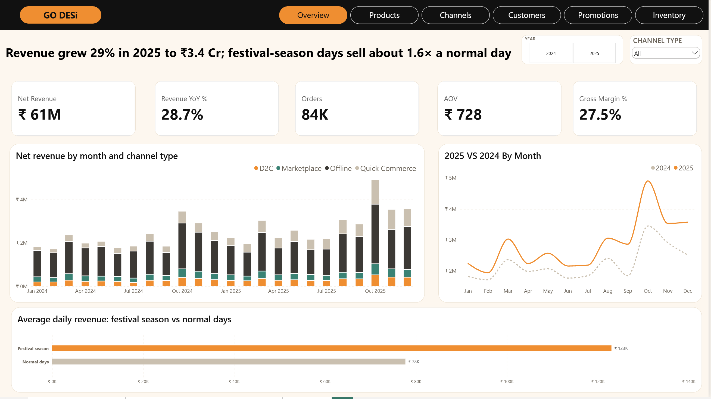
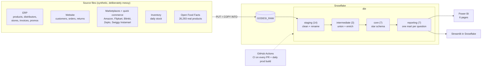
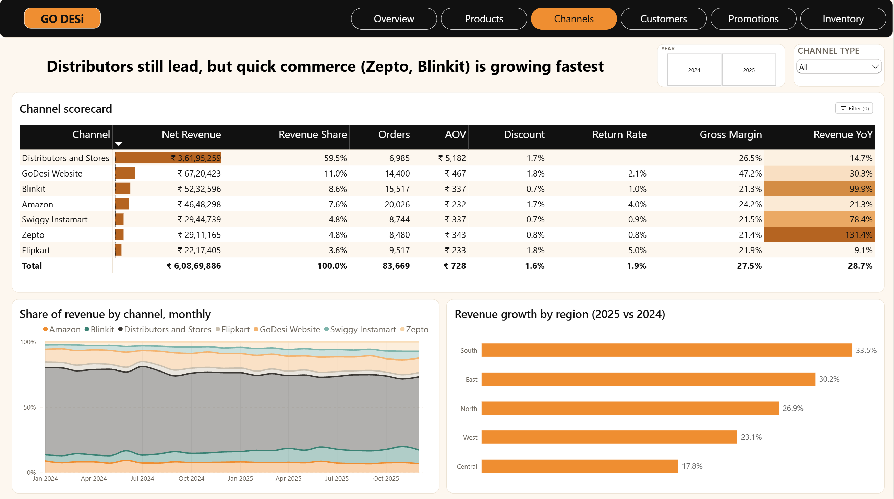
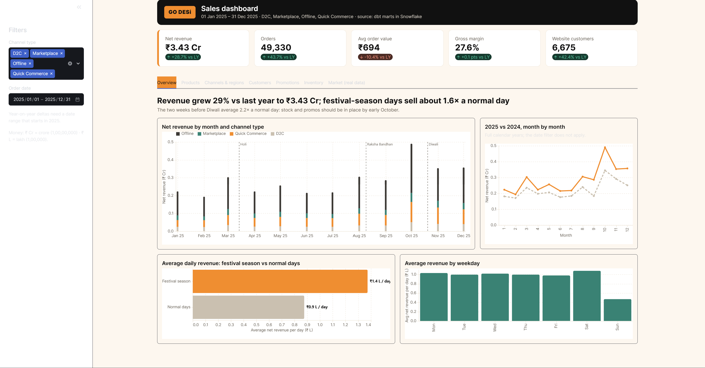

# GoDesi Analytics — a Snowflake + dbt warehouse for a D2C snack brand

[](https://github.com/Pai05/godesi-analytics/actions/workflows/dbt_ci.yml)
[](https://github.com/Pai05/godesi-analytics/actions/workflows/dbt_prod_daily.yml)

> **Unofficial project, built for my internship application to GoDesi.**
> All sales, customer, promotion and inventory data is **synthetic**: generated by
> [`scripts/generate_synthetic_data.py`](scripts/generate_synthetic_data.py), modelled on GoDesi's
> public channels and product range. It does **not** describe GoDesi's real business, and the project is
> not affiliated with GoDesi. Product nutrition data is real ([Open Food Facts](https://world.openfoodfacts.org), ODbL).

A brand that sells through its own website, Amazon and Flipkart, three quick-commerce apps and
offline distributors ends up with sales spread over many systems, each with its own formats. This
project brings them into one tested warehouse and answers the questions a growth or operations team
asks every week.



## Questions it answers

| # | Question | Where |
|---|---|---|
| 1 | How are sales trending, and how big is the festival-season lift? | `mart_sales_daily` · Overview page |
| 2 | Which products drive revenue and margin? | `mart_product_performance` · Products page |
| 3 | Which channels lead, and which are growing fastest? | `mart_channel_performance` · Channels page |
| 4 | Which regions are growing? | `mart_sales_daily` · Channels page |
| 5 | Do website customers come back? | `mart_customer_cohorts` · Customers page |
| 6 | Are we stocking out or overstocking? | `mart_inventory_health` · Inventory page |
| 7 | Did promotions actually lift sales? | `mart_promo_impact` · Promotions page |
| 8 | How does the range compare with other snack brands sold in India? | `mart_market_landscape` (real Open Food Facts data) |

## What the demo data shows

These come from the synthetic data, so they show **what the dashboards surface**, not facts about GoDesi.
With real data, these are the first things I would check.

- **Growth and seasonality:** net revenue grew 28.7% in 2025 to ₹3.43 Cr. Festival-season days averaged
  about 1.6× a normal day, so stock and marketing plans should be built around the festival calendar.
- **Concentration:** 21 of 40 products make 80% of revenue. Candy is the top category.
- **Channels:** distributors and stores are still the biggest channel, but quick commerce grows fastest
  (Zepto +131% year on year). South is the fastest-growing region (+33.5%).
- **Retention:** 7 in 10 website buyers order only once. After the first month, about 4% of a cohort
  reorders in any given month, so repeat purchase is the biggest lever.
- **Promotions:** the biggest lift (+115%) came from Diwali Deals on Amazon at 15% off, not from one of
  the 20%-off promotions, which suggests timing matters more than discount depth.
- **Inventory:** stock-outs peak in October, just before Diwali demand. On 31 Dec 2025, 1 product was out
  of stock and 3 were overstocked (more than 60 days of cover).

## Architecture



**Star schema (core):** `fct_order_items` (one row per order line, 164,596 lines, all channels),
`fct_orders`, and the dimensions `dim_date`, `dim_products`, `dim_channels`, `dim_geography`,
`dim_customers`.

## What's inside

**Snowflake**
- Separate `RAW` and `ANALYTICS` databases; three roles (`LOADER`, `TRANSFORMER`, `REPORTER`) so each
  tool gets only the access it needs. BI tools can read the marts and nothing else.
- Service users log in with key pairs, not passwords. CI has its own key, which can be revoked on its own.
- A resource monitor caps spend at 20 credits a month; the warehouse is X-Small with 60-second auto-suspend.

**dbt**
- 31 models in four layers, 4 seeds (city spellings, channel types, brands, festival calendar).
- The raw data is deliberately messy, the way real exports are: city spellings like "Bangalore" vs
  "Bengaluru" and "Calcutta" vs "Kolkata", prices like `₹40.00` and `Rs. 40`, dates in several formats,
  and an order line pointing at a product code that does not exist (shown as "Unknown product" instead
  of disappearing from the totals).
- **Incremental** fact table (merge on `sales_line_id`), tested by loading a second batch of data.
- **Snapshot** (slowly changing dimension, type 2) that keeps the price history of every product.
- **141 data tests** (keys, relationships, accepted values and ranges, `dbt_utils` checks), 2 **unit
  tests**, and a reconciliation test that checks every staged order line reaches the fact table.
- Column descriptions copied into Snowflake comments; an **exposure** documents the dashboards.

**CI/CD (GitHub Actions)**
- Every pull request builds and tests the whole project in a throw-away schema (`CI_PR_<number>`),
  then drops it. About 1.5 minutes per run.
- A scheduled job rebuilds production every day at 06:00 IST.

**Dashboards**
- **Power BI**, 6 pages: Overview, Products, Channels, Customers, Promotions, Inventory. Star-schema
  model, DAX measures, and a custom theme in GoDesi's colours ([`dashboard/godesi_theme.json`](dashboard/godesi_theme.json)).
  Full report as PDF: [`docs/powerbi_dashboard.pdf`](docs/powerbi_dashboard.pdf).
- **Streamlit in Snowflake**: the same questions in a web app that runs inside Snowflake
  ([`dashboard/streamlit_app.py`](dashboard/streamlit_app.py)).
- A check script ([`checks/verify_data.sql`](checks/verify_data.sql)) compares the dashboard numbers
  with SQL on the marts, so both tools are checked against one source.




## Repository map

| Folder | What's there |
|---|---|
| [`setup/`](setup/) | Snowflake SQL: warehouse, databases, roles, users, cost cap, Streamlit and Power BI access |
| [`scripts/`](scripts/) | Synthetic data generator, stage upload, dbt environment helper |
| [`load/`](load/) | `COPY INTO` scripts that load the files into `GODESI_RAW` |
| [`godesi/`](godesi/) | The dbt project: models, seeds, snapshot, tests, macros |
| [`checks/`](checks/) | SQL that cross-checks the dashboard numbers |
| [`dashboard/`](dashboard/) | Streamlit app, Power BI guide and theme |
| [`.github/`](.github/) | CI and scheduled-build workflows |

## Run it yourself

1. Create a Snowflake account (the free trial is enough) and run the files in [`setup/`](setup/) in order;
   [`setup/README.md`](setup/README.md) walks through it.
2. Generate and load the data: [`load/README.md`](load/README.md).
3. Install dbt and build:
   ```bash
   python -m venv .venv && source .venv/Scripts/activate   # Windows Git Bash
   pip install -r requirements-dbt.txt
   cd godesi
   dbt deps
   dbt build            # dev schema
   dbt build --target prod
   ```
   The dbt profile lives outside the repo (`~/.dbt/profiles.yml`); [`.github/dbt/profiles.yml`](.github/dbt/profiles.yml)
   shows the shape, with the account and key read from environment variables.

## Tech stack

Snowflake · dbt Core 1.12 (dbt-snowflake, dbt_utils) · SQL · Python (pandas) ·
GitHub Actions · Power BI (DAX) · Streamlit · Altair
